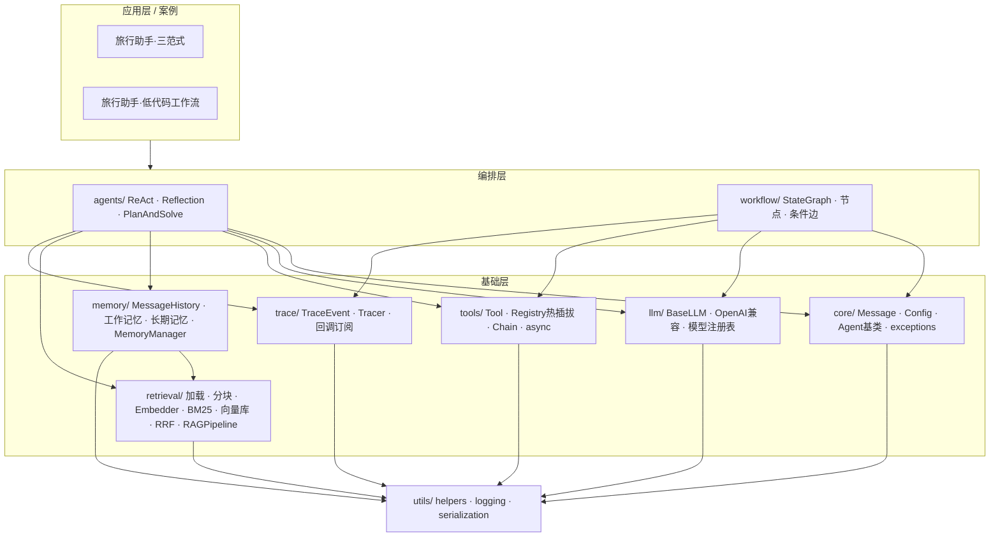

# 架构图（交付物 D2）

> 最终版。Mermaid 源如下，渲染后的 PNG 见同目录 [`architecture.png`](architecture.png)。
> 重新生成 PNG：`py -3.14 scripts/render_architecture.py`

## 分层说明

| 层 | 职责 | 关键组件 |
|---|---|---|
| 应用层 | 案例/演示 | 旅行助手（三范式 + 低代码工作流） |
| 编排层 | 控制流 | `agents/`（三种范式）、`workflow/`（自研 StateGraph） |
| 基础层 | 可复用能力 | `core` / `llm` / `tools` / `memory` / `retrieval` / `trace` |
| 通用工具 | 横切工具 | `utils`（JSON 提取、日志、序列化） |

## 数据流标注

- **trace 贯穿全链路**：Agent / Workflow 的每个关键动作 `emit` 一条 `TraceEvent`，经 `Tracer` 订阅回调 → `ConsoleCallback` / `JSONLFileCallback`（落盘）/ `StatsCallback`（统计）。三范式轨迹直接驱动 D6 对比报告。
- **memory 读写**：`MessageHistory` 管理上下文（token 预算裁剪）；`BaseMemory` 提供可插拔持久化后端（`ShortTermMemory` / `FileMemory` / `SQLiteMemory`），并可用 `as_tool()` 回归工具形态。
- **长期记忆**：`WorkingMemory`（窗口 + TTL）负责会话内摘要，`LongTermMemory`（SQLite，float32 BLOB + 余弦）负责跨会话事实；`MemoryManager` 统一读写并在每轮 `run()` 前 `build_context()` 注入，三范式共享同一入口（`memory` / `memory_enabled`）。
- **RAG 链路**：`load_document`（txt/md/pdf/docx/URL）→ 标题感知分块（保留 `heading_path`）→ `Embedder` 向量化 → SQLite/Qdrant 向量库 + `BM25Index` → `HybridRetriever` RRF 融合 → `RAGPipeline.answer()` 携带引用返回。默认全离线（`HashingEmbedder`），FastEmbed / Qdrant 为可选增强。
- **模型切换**：三家云端（DeepSeek / GLM / OpenAI）均经**同一公司中转站**（OpenAI 兼容网关），`base_url` 不变，换 `model` 名即切换（`llm.use_model(alias)`）。

## 设计原则

1. **万物皆为工具**：Memory 亦可通过 `as_tool()` 回归 Tool 形态；因需持久化/过滤/裁剪而独立成 `memory/` 模块（明确取舍）。
2. **单一职责 + 接口统一 + 模板方法**：`run()` 公开、`_execute()` 抽象，所有范式共享同一入口。
3. **开闭原则**：扩展组件（LLM / Tool / Memory / Callback）用继承拦截 + `super()` 兜底，不改库源码。
4. **依赖注入**：Agent/Workflow 构造注入 `llm / registry / memory / tracer`，便于测试替换为 fake。
