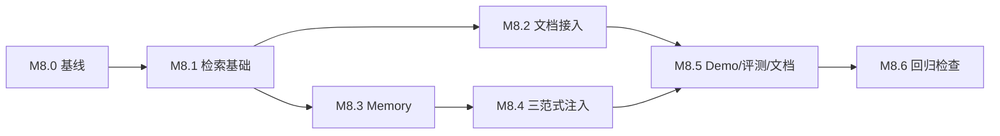

# M8 任务执行提示词清单

> 配套需求：[`docs/m8-memory-rag-requirements.md`](m8-memory-rag-requirements.md)  
> 用途：把 M8 拆成可独立执行的任务，每个任务一段提示词，逐段交给编码 Agent。  
> 原则：**一次只执行一个任务**；先测试后实现；每个任务验收通过后再进入下一个。

---

## 0. 执行总览

| 任务 | 目标 | 依赖 | 主要产出 | 验收命令 |
|---|---|---|---|---|
| M8.0 | 基线确认（只读） | 无 | 基线报告 | `py -3.14 -m pytest -q` |
| M8.1 | 检索基础 | M8.0 | Embedder / BM25 / SQLite 向量库 / RRF | `py -3.14 -m pytest tests/test_retrieval_*.py -q` |
| M8.2 | 文档接入与分块 | M8.1 | TXT/MD/PDF/DOCX/URL + Chunker + RAGPipeline + Qdrant | `py -3.14 -m pytest tests/test_retrieval_*.py -q` |
| M8.3 | Memory | M8.1 | 工作记忆 / 长期记忆 / MemoryManager / MemoryTool | `py -3.14 -m pytest tests/test_memory_*.py -q` |
| M8.4 | 三范式注入 | M8.3 | Agent 统一注入 + 三范式改造 | `py -3.14 -m pytest tests/test_agent_memory_injection.py -q` |
| M8.5 | Demo、评测与文档 | M8.2 / M8.4 | 旅行知识问答 Demo + 两张表 + D7 | `py -3.14 -m examples.demo_travel_memory_rag` |
| M8.6 | 回归与交付检查 | M8.5 | 交付检查报告 | 见任务 7 |



**执行建议**

1. 每个任务单独开一个对话/会话，避免上下文互相污染。
2. 每次先贴「通用前缀」，再贴对应任务提示词。
3. 任务完成后先看 diff、跑验收命令，再 commit；不要一次让 Agent 跑完 M8.1–M8.5。
4. 如果 Agent 试图跨任务改代码，立即停止，要求它只做当前任务。
5. 如果发现需求冲突，先改需求文档，再改代码。

---

## 1. 通用前缀（每个任务都要带）

```text
你在 D:\Pre-research\Hello-Agents\agentflow 仓库内执行 M8 任务。

开始前先完整阅读：
- docs/m8-memory-rag-requirements.md（唯一需求来源）
- docs/architecture.md
- docs/api-design.md
- 当前任务涉及的源码与测试

硬约束：
1. 不改变 v1.0 已有公开行为；现有 94 个测试必须全绿。
2. 本期不做：中转站 /v1/embeddings、OpenAICompatibleEmbedder、Neo4j、OCR、多智能体、Web UI。
3. 默认离线可跑：HashingEmbedder + BM25 + SQLite；FastEmbed 和 Qdrant 必须是可选依赖，缺失时给出清晰错误或 skip，不能静默降级。
4. 不引入 torch / langchain / llama-index / sentence-transformers 等重依赖。
5. 新增依赖只放 pyproject.toml 的 optional extras。
6. 所有公开类/方法写类型注解和中文 docstring；异常继承 agentflow.core.exceptions 的既有层级。
7. 测试不联网、不依赖真实 API Key；需要外部服务时 skip 并说明原因。
8. 只做本任务范围，不顺手重构无关代码；如果发现需求冲突，先停下来在回复中说明，不要自行扩大范围。
9. 实现顺序：先写/补测试，再实现，最后跑全量回归。
10. 完成后按以下格式汇报：
    - 变更文件
    - 核心设计
    - 测试命令与结果
    - 验收命令与结果
    - 未完成项 / 风险
```

---

## 2. 任务提示词

### 任务 1 · M8.0 基线确认（只读）

**目标**：确认当前仓库基线，不改任何代码。  
**依赖**：无。  
**产出**：基线报告。

```text
任务 M8.0：基线确认（只读，不修改任何文件）

请完成：
1. 运行 py -3.14 --version，记录 Python 版本。
2. 运行 py -3.14 -m pytest -q，记录测试数量、通过/失败/跳过。
3. 查看 pyproject.toml，列出当前依赖与 optional extras。
4. 查看 agentflow/memory、agentflow/tools、agentflow/agents、agentflow/core 的公开接口，列出 M8 会复用的类/方法。
5. 运行 git status --short，确认工作区是否有未提交改动。
6. 输出基线报告：Python 版本、测试结果、已有依赖、可复用接口、风险与注意事项。

不要修改任何文件。
```

**通过标准**

- 现有 94 个测试全绿（或有明确的既有失败项并说明与本任务无关）。
- 能列出 `BaseMemory`、`Tool`、`ToolRegistry`、`Agent.run()`、`Config` 等复用点。
- 工作区状态清楚。

---

### 任务 2 · M8.1 检索基础

**目标**：实现 `agentflow/retrieval/` 的最小闭环：类型、Embedder、BM25、SQLite 向量库、RRF 混合检索。  
**依赖**：M8.0 通过。  
**产出**：可离线跑通的「入库 → 检索 → 返回 chunk」。

```text
任务 M8.1：检索基础

允许新增：
- agentflow/retrieval/__init__.py
- agentflow/retrieval/types.py
- agentflow/retrieval/embedder.py
- agentflow/retrieval/bm25.py
- agentflow/retrieval/store_sqlite.py
- agentflow/retrieval/retriever.py
- tests/test_retrieval_embedder.py
- tests/test_retrieval_bm25.py
- tests/test_retrieval_sqlite_store.py
- tests/test_retrieval_hybrid.py

允许修改：
- agentflow/core/exceptions.py（新增异常）
- pyproject.toml（仅 optional extras）

实现要点：
1. types.py 定义 Document / Chunk / RetrievalHit / IngestResult / RAGAnswer，使用 dataclass，提供 to_dict()。
   Chunk 字段至少包含：chunk_id / doc_id / namespace / text / heading_path / page /
   token_count / content_hash / metadata / embedding / embedding_fingerprint。
2. Embedder Protocol：dimension / fingerprint / embed(texts) / embed_query(text)。
3. HashingEmbedder：
   - CJK 字 bigram + 英文小写词；
   - 特征哈希到 512 维；
   - L2 归一化；
   - 同文本同向量、跨进程稳定；
   - fingerprint = "hashing:char-ngram:512"。
4. BM25Index：
   - CJK 字 bigram + 英文按词；
   - k1=1.5，b=0.75；
   - add(chunks) / search(query, top_k, filters)；
   - 支持 namespace / metadata 过滤；
   - 返回 RetrievalHit。
5. SQLiteVectorStore：
   - 构造参数 path；
   - 表 chunks，向量用 float32 BLOB；
   - 余弦相似度（写入时归一化，检索时点积）；
   - upsert / search / delete / count / clear；
   - 支持 namespace 过滤；
   - WAL 模式；写操作加锁。
6. HybridRetriever：
   - dense 召回 + BM25 召回；
   - 候选池 top_k * 4；
   - RRF 融合，k=60；
   - 按 chunk_id + content_hash 去重；
   - 支持 filters；
   - 返回 top_k。
7. exceptions.py 新增：
   RAGError / RetrievalError / EmbeddingMismatchError / DocumentLoadError / MemoryError，
   全部继承 AgentFlowError；EmbeddingMismatchError 继承 RAGError。

测试要求（全部离线）：
- hash：同文本同向量、不同文本不同向量、L2 范数≈1、维度=512。
- BM25：中文/英文排序合理，namespace 过滤生效。
- SQLite：写入后可检索、重启实例后仍在、delete/count/clear 正确。
- Hybrid：融合结果稳定，top_k 生效，重复 chunk 去重。

验收：
py -3.14 -m pytest tests/test_retrieval_*.py -q
py -3.14 -m pytest -q

不要实现 PDF/Word/URL、Memory、Agent 注入、Demo。
```

**通过标准**

- 新增测试全绿，现有 94 个测试全绿。
- 能用一个临时 SQLite 库完成「写入 3 个 chunk → 查询 → 返回结果」。
- 没有引入网络/重依赖。

---

### 任务 3 · M8.2 文档接入与分块

**目标**：支持 TXT/MD/PDF/DOCX/URL 入库，标题感知分块，补齐 `RAGPipeline` 的 ingest/search，Qdrant 可选。  
**依赖**：M8.1 通过。  
**产出**：一条文档从加载、分块、嵌入、入库到检索的完整链路。

```text
任务 M8.2：文档接入与分块

允许新增：
- agentflow/retrieval/loaders.py
- agentflow/retrieval/chunker.py
- agentflow/retrieval/store_qdrant.py
- agentflow/retrieval/pipeline.py
- tests/test_retrieval_loaders.py
- tests/test_retrieval_chunker.py
- tests/test_retrieval_pipeline.py
- tests/test_retrieval_qdrant.py

允许修改：
- agentflow/retrieval/__init__.py
- agentflow/core/exceptions.py
- pyproject.toml（optional extras：rag / qdrant）

实现要点：
1. loaders.py：
   - 按扩展名/URL 分发；
   - .txt / .md：UTF-8、utf-8-sig，失败回退 gb18030；
   - .pdf：懒加载 pypdf，按页提取，保留 page；无文本时抛 DocumentLoadError，
     metadata 标记 needs_ocr=True；
   - .docx：懒加载 python-docx，读段落/表格/标题样式；
   - .doc：明确抛 DocumentLoadError「请另存为 .docx」；
   - URL：仅 http/https；超时 10s；最大 20MB；Content-Type 白名单；
     拒绝 localhost / 私有 / 回环 / 链路本地 IP；重定向后再次校验；
     用标准库 HTMLParser 转文本，不引入 bs4；
   - 限制：单文件 20MB、PDF 300 页、提取文本 5MB、单文档 5000 chunk；
     .docx 做 zip bomb 防护。
2. chunker.py：
   - 标题感知：Markdown 标题、DOCX 标题样式、PDF 页边界；
   - 默认 chunk_tokens=400，overlap=60；
   - CJK 1 字≈1 token；
   - 保留 heading_path（如 "北京 / 故宫 / 开放时间"）和 page；
   - 计算 content_hash，稳定 chunk_id；
   - 单 chunk 不超过 512 token。
3. pipeline.py：
   - RAGPipeline(embedder, vector_store, bm25, retriever, chunker, namespace="travel")；
   - ingest(source, namespace=None, title=None, metadata=None) -> IngestResult；
   - 重复 content_hash 跳过；同一 doc_id 更新时先删旧 chunk；
   - search(query, top_k=5, filters=None) -> list[RetrievalHit]；
   - build_context(hits, max_tokens=2000) -> str，带引用标记；
   - answer() 可先留最小实现或 NotImplemented，M8.5 完善。
4. store_qdrant.py：
   - 懒加载 qdrant-client；
   - QdrantVectorStore(url, api_key, collection)；
   - 创建 cosine collection；upsert / search / delete / count / clear；
   - payload 带 namespace / doc_id / metadata；
   - 无 QDRANT_URL 时集成测试 skip。
5. pyproject.toml extras：
   rag = ["pypdf>=5.0", "python-docx>=1.1"]
   qdrant = ["qdrant-client>=1.12"]

测试要求（全部离线，外部依赖缺失时 skip）：
- .doc 明确报错；扫描 PDF 抛 DocumentLoadError 且 needs_ocr=True；
- DOCX 标题路径正确；chunk token 不超过 512；overlap 生效；
- 重复入库 chunk 数不增长；更新文档旧 chunk 被替换；
- URL：本地 http.server 测 HTML 提取；file:// 和 127.0.0.1 被拒绝；
- Qdrant：无凭据 skip，不阻塞。

验收：
py -3.14 -m pytest tests/test_retrieval_*.py -q
py -3.14 -m pytest -q

不要实现 Memory、Agent 注入、Demo。
```

**通过标准**

- 三种来源（本地文件、PDF/DOCX、URL）至少各有测试覆盖。
- 没有安装 `pypdf` / `python-docx` / `qdrant-client` 时，相关测试 skip 而不是报 ImportError。
- `RAGPipeline.ingest` 能返回 `doc_id`、`chunk_count`、`skipped` 等统计。

---

### 任务 4 · M8.3 Memory

**目标**：实现工作记忆、长期记忆、`MemoryManager` 和 `MemoryTool`。  
**依赖**：M8.1 通过（复用 Embedder / SQLite 思路）。  
**产出**：可跨进程持久化、按 `user_id` 隔离的记忆读写能力。

```text
任务 M8.3：Memory

允许新增：
- agentflow/memory/working.py
- agentflow/memory/long_term.py
- agentflow/memory/manager.py
- agentflow/memory/context.py
- agentflow/tools/memory_tool.py
- tests/test_memory_working.py
- tests/test_memory_long_term.py
- tests/test_memory_manager.py
- tests/test_memory_tool.py

允许修改：
- agentflow/memory/__init__.py
- agentflow/tools/__init__.py
- agentflow/core/config.py
- agentflow/core/exceptions.py
- pyproject.toml（如确有必要，仅 optional extras）

实现要点：
1. WorkingMemory(max_items=50, ttl_minutes=60)：
   - add(content, importance=0.5, metadata=None)；
   - get_context(query, top_k=5, max_tokens=1500)；
   - 评分：(relevance × time_decay) × importance_weight；
   - importance_weight = 0.8 + importance * 0.4；
   - 过期条目自动丢弃；超 max_items 丢低分；
   - 复用 agentflow.memory.estimate_tokens 做 Token 预算。
2. LongTermMemory(embedder, path, user_id="default")：
   - SQLite 表 memories；
   - 字段：memory_id / user_id / memory_type / content / importance /
     created_at / last_accessed_at / access_count / metadata /
     embedding / embedding_fingerprint；
   - add / search / update / remove / clear / stats；
   - float32 BLOB；余弦相似度；user_id 隔离；
   - 写入/检索时校验 embedding fingerprint，不一致抛 EmbeddingMismatchError。
3. context.py：
   - MemoryContext：text / items / working_items / long_term_hits / enabled；
   - 提供 to_dict()。
4. MemoryManager：
   - __init__(embedder, long_term_store, user_id="default", working=None, config=None)；
   - add / search / build_context(query, max_tokens=1500) / record_turn(user_input, assistant_output)；
   - build_context 合并工作记忆与长期记忆，按分数排序，裁剪到 Token 预算；
   - stats / clear；
   - 任何子步骤失败时降级为空上下文，不阻断主流程。
5. MemoryTool：
   - P0 actions：add / search / stats / update / remove / clear_all；
   - 参数校验、get_parameters()、to_openai_schema()；
   - 返回紧凑文本，便于 Agent 直接使用。
6. Config：
   - MemoryConfig(enabled=True, store="sqlite", sqlite_path=".data/memory.sqlite3",
     working_max_items=50, working_ttl_minutes=60, top_k=5)；
   - Config 增加 memory 字段，默认值保证旧代码可直接实例化；
   - from_env 支持 MEMORY_ENABLED / MEMORY_STORE / MEMORY_SQLITE_PATH /
     MEMORY_WORKING_MAX_ITEMS / MEMORY_WORKING_TTL_MINUTES / MEMORY_TOP_K / USER_ID。

测试要求：
- 工作记忆：TTL 过期、max_items、Token 裁剪、重要性加权。
- 长期记忆：跨实例持久化、user_id 隔离、update/remove/clear、fingerprint 不一致报错。
- MemoryManager：build_context 包含偏好关键词；record_turn 后能召回；子步骤失败降级。
- MemoryTool：P0 六个 action 各一条测试。

验收：
py -3.14 -m pytest tests/test_memory_*.py -q
py -3.14 -m pytest -q

不要实现 Agent 注入（M8.4）、Demo（M8.5）。
```

**通过标准**

- 新建 `LongTermMemory` 实例读取同一 SQLite 文件仍能召回。
- 不同 `user_id` 互相不可见。
- `MemoryTool` 能被 `ToolRegistry` 注册并执行。
- 现有 memory 测试不回归。

---

### 任务 5 · M8.4 三范式自动注入记忆

**目标**：在 `Agent.run()` 统一构建 `MemoryContext`，ReAct / Reflection / PlanAndSolve 自动使用。  
**依赖**：M8.3 通过。  
**产出**：有/无记忆可切换，三范式行为一致。

```text
任务 M8.4：三范式自动注入记忆

允许修改：
- agentflow/core/agent.py
- agentflow/core/config.py
- agentflow/agents/react_agent.py
- agentflow/agents/reflection_agent.py
- agentflow/agents/plan_solve_agent.py
- agentflow/core/exceptions.py（如确有必要）

允许新增：
- tests/test_agent_memory_injection.py

实现要点：
1. Agent.__init__ 已接受 memory 参数，保持兼容：
   - 新形态：MemoryManager，具备 build_context / record_turn；
   - 旧形态：BaseMemory，只有 recall(input_text) -> str；
   - 两种都要支持。
2. Agent.run()：
   - 在 _execute 之前构建 MemoryContext；
   - emit("memory.build", data={...})；
   - 把 memory_context=ctx 传给 _execute；
   - 成功后调用 memory.record_turn(input_text, result)，emit("memory.write")；
   - 失败时不写记忆；记忆构建失败时 emit("memory.error") 并降级为空上下文。
3. memory_enabled=False：
   - 不构建、不注入、不写入；
   - 消息列表与 v1.0 完全一致。
4. ReActAgent：
   - 记忆文本追加到 system prompt；
   - 最近相关记忆作为额外消息插在当前 user 消息之前；
   - 保持 FINISH 检查先于工具查找。
5. ReflectionAgent：
   - 记忆文本前置到 task；
   - initial / reflect / refine 三段都能看到。
6. PlanAndSolveAgent：
   - 记忆文本前置到 planner 和 executor 的 question。
7. Config：
   - memory.enabled 默认 True；
   - from_env 支持 MEMORY_ENABLED=false。

测试要求：
- fake MemoryManager 返回固定文本：
  - ReAct system prompt 包含该文本；
  - Reflection task 包含该文本；
  - PlanAndSolve planner question 包含该文本。
- record_turn 成功调用一次；_execute 抛异常时不调用。
- 旧 BaseMemory 的 recall 路径可用。
- memory_enabled=False 时消息列表与基线一致。
- 现有 94 个测试全绿。

验收：
py -3.14 -m pytest tests/test_agent_memory_injection.py -q
py -3.14 -m pytest -q

不要改 Demo/eval；不要改 M8.3 的 Memory 实现，除非发现明确 bug。
```

**通过标准**

- 三范式都能看到记忆上下文。
- 关闭开关后行为与 v1.0 一致。
- 记忆构建失败不会让 Agent 主流程失败。

---

### 任务 6 · M8.5 Demo、评测与文档

**目标**：交付旅行知识问答 Demo、召回表、带/不带 RAG 对照表、D7 文档。  
**依赖**：M8.2 / M8.4 通过。  
**产出**：可运行的 Demo + 可复现的评测表 + 文档。

```text
任务 M8.5：旅行知识问答 Demo + 评测 + 文档

允许新增：
- examples/demo_travel_memory_rag.py
- scripts/eval_rag.py
- data/eval/travel_qa.jsonl
- docs/m8-memory-rag-eval.md
- tests/test_demo_memory_rag.py
- tests/test_eval_rag.py

允许修改：
- README.md
- docs/api-design.md
- docs/architecture.md
- pyproject.toml（optional extras：rag / embed / qdrant）
- examples/travel_workflow.py（仅在确有必要时，尽量不改）

实现要点：
1. examples/demo_travel_memory_rag.py：
   - 默认离线：HashingEmbedder + BM25 + SQLite；
   - 参数：--embed hashing|fastembed、--ingest path/url、--query、--out-dir；
   - 复用 TravelDeps / build_travel_graph / make_registry，不另起业务；
   - 演示：
     a. 三范式有/无记忆对比；
     b. 多轮改行程（第二天下雨、换不爬坡景点）；
     c. 跨会话记忆召回；
     d. 上传 PDF/DOCX/URL 后回答带引用；
     e. 带/不带 RAG 回答对照；
   - 输出：trace.jsonl、memory.json、rag_eval.md。
2. scripts/eval_rag.py：
   - 读取 data/eval/travel_qa.jsonl；
   - 字段：question / gold_chunk_ids / gold_answer / city / tags；
   - 指标：Recall@1 / Recall@3 / Recall@5、MRR；
   - 对照：BM25、Hash+BM25、FastEmbed+BM25；
   - 回答指标：事实准确率、引用覆盖率、幻觉率、完整度 1–5；
   - 带 RAG / 不带 RAG 对照；
   - 离线用确定性 answerer；--online 可选接真实 LLM；
   - 输出 Markdown 表格 + JSON 原始结果。
3. docs/m8-memory-rag-eval.md（D7）：
   - 设计说明；
   - 召回命中率表；
   - 带/不带 RAG 回答对照表；
   - 结论与局限。
4. 文档更新：
   - docs/api-design.md 增加 retrieval / memory / tools 章节；
   - docs/architecture.md 增加 Retrieval 层与 Memory 数据流；
   - README.md 增加 M8 里程碑、运行命令、D7 交付物。
5. pyproject.toml extras：
   rag = ["pypdf>=5.0", "python-docx>=1.1"]
   embed = ["fastembed>=0.9,<1.0"]
   qdrant = ["qdrant-client>=1.12"]

测试要求：
- demo 离线 smoke test：退出码 0，生成 trace.jsonl / memory.json / rag_eval.md。
- eval 在小 fixture 上能算出 Recall/MRR，不联网。
- 文档包含两张表与 M8 运行命令。
- 不引入中转站 embedding、Neo4j。

验收：
py -3.14 -m pytest -q
py -3.14 -m examples.demo_travel_memory_rag --out-dir demo_output
py -3.14 scripts/eval_rag.py --backend hashing --out docs/m8-memory-rag-eval.md
（可选）安装 fastembed 后：py -3.14 -m examples.demo_travel_memory_rag --embed fastembed
```

**通过标准**

- 离线默认模式跑通，不联网、不需要 API Key。
- 两张表有真实数据（不是占位符）。
- 回答带引用；无命中时明确说「未找到」。
- FastEmbed/Qdrant 缺失时给出清晰安装提示或 skip。

---

### 任务 7 · M8.6 回归与交付检查

**目标**：全量回归、交付物检查、风险清单。  
**依赖**：M8.5 通过。  
**产出**：交付检查报告。

```text
任务 M8.6：回归与交付检查（尽量只读）

请完成：
1. 运行 py -3.14 -m pytest -q，记录测试数量、耗时、失败/跳过。
2. 运行 py -3.14 -m examples.demo_travel_memory_rag --out-dir demo_output，确认退出码 0 与输出文件。
3. 运行 py -3.14 scripts/eval_rag.py --backend hashing --out docs/m8-memory-rag-eval.md，确认两张表生成。
4. 检查禁用项是否被引入：
   grep -R "v1/embeddings\|OpenAICompatibleEmbedder\|neo4j\|torch\|langchain\|llama_index" agentflow examples scripts tests
   如果命中，逐条说明是否属于本期范围。
5. 检查 pyproject.toml optional extras 是否正确；确认没有把可选依赖放进主依赖。
6. 检查 README / docs/architecture.md / docs/api-design.md / docs/m8-memory-rag-eval.md 的链接与命令。
7. 检查 git status 与 git diff --stat：
   - 是否有无关重构；
   - 是否有密钥、大文件、模型文件、SQLite 数据库被误加入；
   - 是否有未跟踪的临时文件。
8. 输出交付检查报告：通过项、失败项、风险、建议下一步。

不要修改代码，除非发现明确阻塞问题；如有修改，说明原因并重跑验收。
```

**通过标准**

- 全量测试全绿。
- Demo 与 eval 均可复现。
- 没有禁用依赖/中转站代码。
- 没有密钥/大文件入库。
- 交付文档链接可用。

---

## 3. 每个任务的完成定义（DoD）

一个任务只有同时满足以下条件才算完成：

- [ ] 代码已实现，类型注解与中文 docstring 齐全。
- [ ] 新增测试覆盖任务要点，测试离线可跑。
- [ ] 本任务验收命令通过。
- [ ] `py -3.14 -m pytest -q` 全量通过。
- [ ] 没有修改任务范围外的代码。
- [ ] 汇报中包含变更文件、测试结果、风险。
- [ ] 已 commit（提交信息建议：`feat(M8.x): ...`）。

---

## 4. 常见失败处理

| 情况 | 处理 |
|---|---|
| FastEmbed 安装/下载失败 | 保持 `EMBEDDING_BACKEND=hashing`，在报告中记录；不要静默降级 |
| Qdrant 无凭据 | 集成测试 skip；SQLite 必须可用 |
| PDF 提取乱码 | 标记解析质量；提示用户；不要假装成功 |
| 测试数量变化 | 说明新增/删除原因；不得删除既有测试来“变绿” |
| Agent 想跨任务重构 | 停止，要求只做当前任务；重构另开任务 |
| 需求冲突 | 先改 `docs/m8-memory-rag-requirements.md`，再改代码 |
| 评测结果不理想 | 如实记录；不要调参伪造命中率；分析原因 |

---

## 5. 最终交付清单

- [ ] 现有 94 个测试 + 新增测试全绿。
- [ ] 离线 Demo 可跑：`py -3.14 -m examples.demo_travel_memory_rag`。
- [ ] 评测可跑：`py -3.14 scripts/eval_rag.py --backend hashing`。
- [ ] 召回表：Recall@1/3/5 + MRR。
- [ ] 回答对照表：带/不带 RAG。
- [ ] PDF / DOCX / URL 入库可用；`.doc` 与扫描 PDF 有明确错误。
- [ ] 三范式自动注入记忆；`MEMORY_ENABLED=false` 可关闭。
- [ ] SQLite 默认；Qdrant 可选；FastEmbed 可选。
- [ ] 无中转站 embedding、无 Neo4j。
- [ ] D7 文档完成；API/架构/README 已更新。
