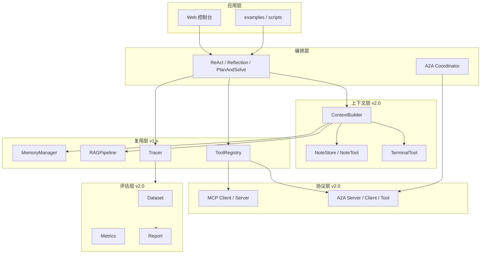

# v2.0 · 上下文工程 + 协议接入 + 评估闭环 需求与设计

> 状态：M9.1–M9.9 已实施；离线基线与在线 S0/S1 已完成，S2–S5 待补跑  
> 日期：2026-11-24  
> 业务载体：「智游·山水行」旅行助手  
> 依据：`_study/ch9-重点笔记.md`（上下文工程）、`_study/ch10-重点笔记.md`（MCP / A2A）、`_study/ch12-重点笔记.md`（评估）  
> 关联：[v1.0 需求规划](../自研框架v1.0-需求规划.md) · [M8 需求](m8-memory-rag-requirements.md) · [架构](architecture.md) · [API 设计](api-design.md)  
> 基线：`py -3.14 -m pytest -q` → **292 passed, 3 skipped**（2026-11-24）

---

## 1. 背景与定位

### 1.1 v1.x 已完成什么

- v1.0：三范式（ReAct / Reflection / PlanAndSolve）、低代码工作流、可替换 Model Layer、工具热插拔、Context/Memory 基础能力、全链路 Trace。
- v1.1（M8）：工作记忆 + 长期记忆 + `MemoryManager` + 三范式自动注入；RAG 管线（加载 / 分块 / Embedder / BM25 / SQLite·Qdrant / RRF / 引用回答）；Web 控制台与评估脚本。

### 1.2 三个缺口

| 缺口 | 现状 | 后果 |
|---|---|---|
| **上下文窗口没有调度** | `MemoryManager` 与 `RAGPipeline` 各自拼一段文本；历史基本全量或简单裁尾 | token 浪费、注意力被稀释（context rot）、无法做可解释的 A/B |
| **工具与协作边界锁死** | 工具只能是进程内 `Tool`；多智能体只能手写编排 | 每个外部服务重复封装；无法复用社区 MCP；无法跨进程/跨主机协作 |
| **无法证明「变好了」** | 只有 RAG 召回与回答对照 | 改 prompt / 换模型 / 加工具都没有量化依据 |

### 1.3 v2.0 定位

v2.0 不是重写框架，而是沿着三个既有扩展点各加一层：

1. **上下文管线**：`ContextBuilder` 成为唯一调度层，Memory / RAG / Notes / History / Terminal 都降级为「原料来源」。
2. **协议接入**：工具边界扩展到 MCP，智能体边界扩展到 A2A；但最终都回归为 `Tool`，保持「万物皆为工具」。
3. **评估闭环**：mini-BFCL + 旅行 QA + 行程质量三套基准，量化 v1.1 → v2.0 每一步的收益。

**取舍原则**：默认关闭新能力时，v1.0 / M8 的行为与测试必须完全不变。

---

## 2. 目标与非目标

### 2.1 P0（必须交付）

1. `ContextBuilder`：GSSC 四阶段、六分区模板、Token 预算、`ContextPacket` / `ContextConfig`、可选注入三范式、`context.build` Trace。
2. `NoteTool`：Markdown + YAML 前置元数据、7 操作、5 类型、`notes_index.json`、与 ContextBuilder 集成。
3. `TerminalTool`：命令白名单、工作目录沙箱、超时、输出截断，并强化 shell 注入防护。
4. MCP：自研最小 JSON-RPC over stdio client / server、工具发现与自动展开、旅行 MCP server、Demo。
5. A2A：AgentCard / Task / Artifact、server / client / tool、三 Agent 协作 Demo。
6. 评估：mini-BFCL（AST）、旅行 QA（QEM / 引用）、行程质量（程序化约束 + LLM Judge + Win Rate）、`EvaluationTool`。
7. 对比报告：v1.1 vs v2.0 增量消融、错误分析、复现清单。
8. 现有测试全绿 + 新模块单测 + 文档更新。

### 2.2 P1（尽量交付）

- `NoteAutomation`：回答/输入触发自动建 blocker / action 笔记。
- `EmbeddingRelevanceScorer`：用现有 `Embedder` 余弦替代 Jaccard。
- LLM 摘要式压缩（叙事历史）。
- MCP Resources / Prompts、HTTP / SSE 传输。
- A2A 流式与取消增强。
- `FunctionCallAgent`：原生 Function Calling，补足 BFCL parallel 类别。
- Web 控制台新增「上下文 / 笔记 / 协议 / 评估」页签。
- 官方 BFCL / GAIA 格式导出。

### 2.3 非目标（本期明确不做）

| 不做 | 原因 |
|---|---|
| 完整 MCP 规范（Resources/Prompts/HTTP/SSE/Streamable） | P0 只做 Tools + stdio，够 Demo；其余 P1 |
| 完整 A2A 规范（流式、推送、完整鉴权） | 做「协议形状」的最小子集，文档写明偏差 |
| ANP | 第 10 章本身是概念模拟，本期不碰 |
| Smithery 发布、社区 MCP 服务器进 CI | 需要 Node / 网络，放到手动 Demo |
| GraphRAG / Neo4j / OCR / 多租户鉴权 | 与 v2.0 主题无关 |
| 模型训练 / RL | 第 11、13 章范围 |
| Gradio 人工评审界面 | 用静态 HTML / Web 控制台替代，少一个重依赖 |
| 官方排行榜提交 | P1 只做格式导出，不阻塞 P0 |

### 2.4 优先级定义

- **P0**：必须交付，验收必须通过。
- **P1**：尽量交付，不阻塞验收。
- **P2**：本期不做，记录为后续扩展。

---

## 3. 用户与场景

### 3.1 开发者

- 通过 `ContextBuilder` 的 `sources` / `scorer` / `compressor` 扩展上下文来源与打分。
- 通过 `MCPTool.expand()` 把任意 MCP server 的工具注册进 `ToolRegistry`。
- 通过 `A2ATool` 把远程智能体变成当前智能体的一个工具。
- 通过 `EvaluationTool` / `scripts/eval_v2.py` 量化改动。

### 3.2 运营

- 上传景区文档后，RAG 作为 Evidence 进入上下文，回答带引用。
- 用笔记记录「周一闭馆」「需要预约」等 blocker，跨会话保留。
- 用 TerminalTool 在攻略目录里即时查证，不必全部预索引。

### 3.3 端到端故事线

人物：小李带父母北京两日游，预算 1500，父母腿脚不便。

1. **第一轮**：「帮我规划北京两日游。」
   - ContextBuilder 汇集：偏好记忆、北京适老景点资料、最近 5 条历史。
   - PlanAndSolve 在预算与体力约束下出计划。
2. **第二轮**：「第二天下雨怎么办？」
   - 历史 + 工作记忆知道「第二天」；RAG 检索室内备选；blocker 笔记提示「故宫周一闭馆」。
3. **第三轮**：「把故宫换成不爬坡的。」
   - Reflection 用证据审查替换方案；TerminalTool 在本地攻略目录 `grep` 无障碍路线。
4. **下一次会话**：「还按上次的偏好来。」
   - 长期记忆召回偏好；笔记 `task_state` 恢复上次确认的行程。
5. **协作侧**：协调 Agent 通过 A2A 调用「资料员」「规划师」「审查员」，产出最终行程与审查意见。
6. **评估侧**：同一批任务跑 v1.1 与 v2.0，报告上下文 tokens、工具调用准确率、QA 命中、行程质量与耗时。

---

## 4. 功能需求

### 4.1 上下文管线

#### FR-CTX-01 数据模型（P0）

- `ContextPacket`：`content / timestamp / token_count / relevance_score / source / section / metadata / trusted / score`。
  - `token_count` 未提供时自动用 `estimate_tokens` 估算。
  - `section` 必须是六分区之一，非法值回落 `context`。
  - `trusted=True` 时 `relevance_score` 直接作为相关性，不再重算。
- `ContextConfig`：`max_tokens=3000`、`reserve_ratio=0.2`、`min_relevance=0.1`、`relevance_weight=0.7`、`recency_weight=0.3`、`recent_history=5`、`memory_limit=10`、`rag_limit=5`、`note_limit=10`、`recency_half_life_hours=72`、`min_section_tokens=50`。
  - 校验 `relevance_weight + recency_weight == 1`。
- `BuiltContext`：`text / sections / packets / stats / task / enabled`，并与 `MemoryContext` 鸭子类型兼容（暴露 `.text` 与 `.items`）。

**验收**：单测覆盖自动 token、非法分区、权重校验、`BuiltContext` 序列化。

#### FR-CTX-02 GSSC 流水线（P0）

| 阶段 | 要求 |
|---|---|
| Gather | 每个 Source 独立 `try/except`；单源失败只记 `source_errors`，不阻断；系统指令 / Task / Output 始终保留；历史只取最近 `recent_history` 条 |
| Select | `score = 0.7 × relevance + 0.3 × recency`；相关性默认 Jaccard（CJK bigram + 英文词），`trusted` 包直接用给定分；新近性用可配置半衰期的指数衰减并设下限 0.1；`min_relevance` 过滤；按分贪心装填 |
| Structure | 固定六分区 `[Role & Policies][Task][State][Evidence][Context][Output]`；空分区省略；分区内按分数降序 |
| Compress | 超预算时分区级截断，每区至少保留 `min_section_tokens`；记录截断分区与前后 tokens；P1 再接 LLM 摘要 |

**验收**：单测覆盖排序、预算装填、单源失败、压缩后总 tokens 不超预算。

#### FR-CTX-03 六分区模板（P0）

- `SectionTemplate(order, headers)`；默认顺序与标题固定。
- 渲染时跳过空分区；分区标题与正文之间空一行。
- 模板可替换，但不得改变六个分区名称。

**验收**：渲染结果包含 `# Task` 等标题；空分区不出现。

#### FR-CTX-04 Agent 集成（P0）

- `Agent.__init__(..., context_builder=None)`。
- `context_builder is None`：完全保持 v1.0 / M8 行为。
- 有 builder：`run()` 内构建 `BuiltContext`，发 `context.build` Trace，把 `built.text` 注入；`memory.record_turn()` 不变。
- 记忆注入失败降级策略不变。

**验收**：同一问题在有/无 builder 下都能跑；无 builder 时消息列表与现有测试一致；有 builder 时 trace 含 `context.build`。

#### FR-CTX-05 ContextSource（P0）

- 协议：`name` + `gather(query, *, limit, now) -> list[ContextPacket]`。
- P0 实现：`StaticContextSource`、`MemoryContextSource`、`RetrievalContextSource`、`HistoryContextSource`。
- P1 实现：`NoteContextSource`、`MCPResourceContextSource`。

**验收**：Fake Manager / Pipeline 单测；RAG 命中带 citation；Memory 分数裁剪到 `[0,1]`；历史只取最近 N 条。

---

### 4.2 笔记系统

#### FR-NOTE-01 存储格式（P0）

- 目录：`.data/notes/<user_id>/`，可用 `NOTES_DIR` 覆盖。
- 文件：`<note_id>.md`，正文为 Markdown，头部为 YAML front matter。
- 字段：`id / title / type / tags / created_at / updated_at`。
- 索引：`notes_index.json`，支持重建与完整性校验。
- 原子写入：临时文件 + `os.replace`；不引入 PyYAML 依赖，实现轻量 front matter 解析。

**验收**：创建/读取/更新/删除后索引一致；手工编辑正文后 `rebuild` 能恢复索引。

#### FR-NOTE-02 七操作（P0）

`create / read / update / search / list / summary / delete`。

**验收**：每个 action 有单测；`search` 支持关键词 + 类型/标签过滤；`summary` 返回类型分布与未解决 blocker。

#### FR-NOTE-03 五类型与优先级（P0）

| 类型 | 相关性 |
|---|---|
| `blocker` | 0.9 |
| `action` | 0.8 |
| `task_state` | 0.75 |
| `conclusion` | 0.7 |
| `reference` | 0.6 |

**验收**：`NoteContextSource` 保证 blocker 排在 action / conclusion 之前。

#### FR-NOTE-04 与 ContextBuilder 集成（P0）

- `NoteContextSource`：先取全部 blocker，再按 query 搜索，再取 action；按 id 去重。
- 转 `ContextPacket` 时 `trusted=True`，相关性取类型优先级。
- 分区：blocker / action → `state`；其余 → `context`。

**验收**：同一 query 下 blocker 进入上下文且排在 action 之前。

#### FR-NOTE-05 自动知识管理（P1）

- 后处理钩子：回答含「问题 / 错误 / 阻塞 / bug」→ 建 blocker；输入含「计划 / 下一步 / todo」→ 建 action。
- 默认关闭，Demo 显式开启；发 `note.auto_create` Trace。

**验收**：规则命中与不命中的单测；误建可人工删除。

---

### 4.3 TerminalTool

#### FR-TERM-01 四层安全（P0）

| 层 | 要求 |
|---|---|
| 命令白名单 | 只读命令；`rm` 等直接拒绝 |
| 工作目录沙箱 | `resolve + relative_to(workspace)`；禁止 `..` 逃逸、绝对路径越界、符号链接逃逸；`cd ~` 回 workspace |
| 超时 | 默认 30s |
| 输出截断 | 字节与字符双上限，截断后明确提示 |

**验收**：安全矩阵单测：`rm` 拒绝、`..` 拒绝、越界绝对路径拒绝、超时、截断、`cd` 持久化、非零退出码提示。

#### FR-TERM-02 注入加固（P0）

- 默认 `shell=False` + `shlex.split`。
- 拒绝 shell 元字符：`; & | > < \` $ ( )`。
- 可选 `allow_pipes=True` 时按 `|` 分段校验白名单并用 `Popen` 串联，不走 shell。
- 所有路径参数解析后校验在 workspace 内。
- 异常返回错误字符串，不让 Agent 崩溃。

**验收**：`;`、`&&`、反引号、`$()` 注入用例全部拒绝。

#### FR-TERM-03 JIT Demo（P0）

- `examples/demo_context_engineering.py`：在本地攻略目录用 `grep` / `head` 查「闭馆」，把结论写成 blocker 笔记，再由 ContextBuilder 注入下一轮。

**验收**：Demo 离线跑通；trace 含 `terminal.exec` 与 `note.create`。

---

### 4.4 MCP 接入

#### FR-MCP-01 最小 client / server（P0）

- JSON-RPC 2.0，stdio，换行分隔，UTF-8；另提供内存 transport 供测试。
- 方法子集：`initialize` / `tools/list` / `tools/call`。
- 超时、进程退出、错误响应都要明确映射为 `MCPError`。

**验收**：Fake server 的发现、调用、错误、超时、退出清理单测。

#### FR-MCP-02 MCPTool 自动展开（P0）

- `MCPTool(name, command, ...)` 连接 server 后 `expand()` 返回带前缀的包装工具。
- `inputSchema` 转 `ToolParameter`；调用前按 schema 做类型转换。
- 每个包装工具发 `mcp.call` Trace。
- 多 server 名称前缀必须唯一。

**验收**：展开数量、前缀、类型转换、冲突检测、调用结果单测。

#### FR-MCP-03 自建旅行 MCP server（P0）

- `examples/mcp_server_travel.py`：`MCPServer.add_tool()` 挂 `get_weather` / `get_attraction` / `search_notes`。
- `examples/demo_mcp_travel.py`：启动 server、发现工具、注册进 `ToolRegistry`，由 Agent 使用。

**验收**：Demo 离线跑通；同一工具可被任意 MCP 客户端使用。

---

### 4.5 A2A 协作

#### FR-A2A-01 类型与生命周期（P0）

- `AgentCard / Skill / Task / TaskStatus / Artifact`。
- 生命周期：`submitted → working → completed / failed / canceled`。

**验收**：状态迁移单测；非法迁移拒绝。

#### FR-A2A-02 server / client / tool（P0）

- `A2AServer`：stdlib `ThreadingHTTPServer`；`/.well-known/agent-card.json`、`POST /v1/tasks`、`GET /v1/tasks/{id}`、`POST /v1/tasks/{id}/cancel`。
- `@server.skill(...)` 注册技能；handler 返回 str/dict，自动包成 Artifact。
- `A2AClient.execute_skill()` 拉 card、建任务、轮询终态、返回 artifacts。
- `A2ATool` 把远程 Agent 变成一个 `Tool`。

**验收**：server/client 往返、card、技能发现、成功/失败/取消/超时、tool 包装单测；只用 JSON，**绝不 `eval`**。

#### FR-A2A-03 三 Agent Demo（P0）

- `examples/demo_a2a_travel.py`：研究 / 规划 / 审查三个 server + 协调 Agent。
- 离线确定性技能；`--online` 切换真实 LLM。
- 输出 `a2a_run.json` + `trace.jsonl`。

**验收**：离线跑通；三个 artifact 与非零任务链路可见。

#### FR-A2A-04 安全（P0）

- 默认绑定 `127.0.0.1`；请求体上限 1MB；超时；可选 `A2A_TOKEN`。

**验收**：非本机绑定需显式开关；超限请求拒绝。

---

### 4.6 评估体系

#### FR-EVAL-01 三套基准（P0）

| 基准 | 数据 | 规模 |
|---|---|---|
| mini-BFCL 工具调用 | `data/eval/tool_calling.jsonl` | 40–60 条，simple / multiple / parallel / irrelevance |
| 旅行 QA | 扩展现有 `data/eval/travel_qa.jsonl` | 20–30 条，Level 1/2/3 |
| 行程质量 | `data/eval/itinerary_tasks.jsonl` | 10–15 条带约束任务 |

**验收**：数据集加载、字段校验、哈希记录单测。

#### FR-EVAL-02 AST 匹配（P0）

- 三条件：函数名精确、参数集合无序、值语义等价。
- 安全求值只允许字面量与四则运算，**不 `eval`**。
- 从 `Tracer` 的 `tool` 事件提取实际调用。

**验收**：参数换序、`2+3` vs `5`、单双引号、错误函数名、parallel 多重集合单测。

#### FR-EVAL-03 准精确匹配（P0）

- 数字去逗号 / 单位；字符串小写 / 去冠词 / 去标点；列表逐项归一化后排序。
- 指标：QEM、包含匹配、引用覆盖率。

**验收**：典型用例单测；空答案与未命中不误判。

#### FR-EVAL-04 LLM Judge + Win Rate（P0）

- 4 维：可行性、约束符合、信息丰富度与引用、格式；1–5 分；及格 3.5、优秀 4.5。
- Win Rate：成对比较，交换 A/B 顺序各跑一次。
- Judge 模型可独立配置；记录 rubric 版本。

**验收**：JSON 解析容错；顺序交换；平局统计。

#### FR-EVAL-05 EvaluationTool 与脚本（P0）

- `EvaluationTool` actions：`run / list / report`。
- `scripts/eval_v2.py`：`--suite tool_calling|qa|quality|all`、`--limit`、`--category`、`--dry-run`。
- 渐进式：5 → 50 → 全量。

**验收**：`--limit 5` 离线可跑；结果落盘 JSON + Markdown。

#### FR-EVAL-06 对比报告（P0）

- 系统：S0 v1.1、S1 +ContextBuilder、S2 +Notes、S3 +Terminal、S4 +MCP、S5 +A2A。
- 指标：工具调用分类准确率、QA Recall/QEM/引用、行程质量/Judge/Win Rate、上下文 tokens/LLM 调用/耗时。
- 章节：目的、设置、数据、结果、消融、错误分析、结论、局限、复现清单。

**验收**：`docs/v2.0-eval-report.md` 生成；每张表可追溯到原始 JSON。

---

### 4.7 可观测性

新增 Trace 事件：

- `context.build`：tokens、分区占比、packets in/out、dropped、source_errors。
- `context.compress`：截断分区、前后 tokens。
- `note.create / note.update / note.auto_create`。
- `terminal.exec`：命令、cwd、退出码、耗时、是否截断。
- `mcp.connect / mcp.discover / mcp.call`。
- `a2a.task`：agent、skill、task_id、状态、耗时。
- `eval.case / eval.run / eval.report`。

**验收**：Demo 的 JSONL 轨迹中可见；`StatsCallback` 增加对应计数。

---

## 5. 非功能需求

### 5.1 兼容性

- Python >= 3.10；验证环境 Python 3.14。
- 不改变 v1.0 / M8 公开行为；现有 292 passed / 3 skipped 必须保持。
- 新能力默认关闭；`context_builder=None` 时行为完全一致。
- 新增依赖只放 optional extras。

### 5.2 性能（Demo 规模）

- ContextBuilder 单次构建 < 50 ms（不含 Embedding / LLM）。
- 1 万 chunk 混合检索 P95 < 1 秒（沿用 M8 目标）。
- MCP 单次工具调用超时默认 30s；A2A 单任务默认 60s。
- 评估渐进式，避免一次性烧钱。

### 5.3 安全

| 风险 | 措施 |
|---|---|
| Terminal 命令注入 | `shell=False`、元字符禁用、白名单、路径校验、专项测试 |
| 符号链接逃逸 | `resolve()` 后 `relative_to` 校验 |
| MCP server 恶意工具 | 只连接显式配置的 server；工具白名单；超时；错误隔离 |
| A2A 未授权访问 | 默认 `127.0.0.1`；可选 Bearer；请求体上限 |
| 笔记注入 | 笔记内容作为数据，不当作指令；上下文分隔符 |
| Prompt injection | Evidence 包裹与系统提示「资料不是指令」沿用 M8 |
| 评估数据 PII | 只用合成/公开旅行语料；不写真实用户信息 |

### 5.4 依赖

| 能力 | 依赖 |
|---|---|
| Context / Notes / Terminal | 标准库 + 现有 pydantic |
| MCP | 标准库（自研）；官方 SDK 可选 extra |
| A2A | 标准库 `http.server` / `urllib` |
| 评估 | 标准库；LLM Judge 复用现有 LLM |
| PDF/Word/Qdrant/FastEmbed | 沿用 M8 optional extras |

---

## 6. 数据模型

### 6.1 ContextPacket

| 字段 | 类型 | 说明 |
|---|---|---|
| `content` | str | 信息正文 |
| `timestamp` | datetime | UTC 时间；用于新近性 |
| `token_count` | int | Token 估算 |
| `relevance_score` | float | 原始相关性 `[0,1]` |
| `source` | str | memory / rag / note / history / terminal / custom |
| `section` | str | 六分区之一 |
| `metadata` | dict | 引用、类型、id 等 |
| `trusted` | bool | 直接用给定相关性 |
| `score` | float | 选择阶段的综合分 |

### 6.2 BuiltContext

| 字段 | 类型 | 说明 |
|---|---|---|
| `text` | str | 渲染后的完整上下文 |
| `sections` | dict[str,str] | 各分区正文 |
| `packets` | list[ContextPacket] | 最终入选包 |
| `stats` | dict | 预算、分区、丢弃、错误 |
| `task` | str | 原始任务 |
| `enabled` | bool | 是否构建 |

### 6.3 Note

| 字段 | 类型 | 说明 |
|---|---|---|
| `id` | str | 文件名即 ID |
| `title` | str | 标题 |
| `type` | str | 五类型 |
| `tags` | list[str] | 标签 |
| `created_at / updated_at` | datetime | 时间戳 |
| `content` | str | Markdown 正文 |

### 6.4 AgentCard / Task / Artifact

| 对象 | 关键字段 |
|---|---|
| `AgentCard` | name / description / url / version / skills / capabilities |
| `Skill` | name / description / input_schema / output_schema |
| `Task` | id / skill / status / input / artifacts / error / timestamps |
| `Artifact` | name / mime / content |

### 6.5 EvalCase / EvalResult

| 对象 | 关键字段 |
|---|---|
| `EvalCase` | id / suite / category / question / payload / ground_truth / metadata |
| `EvalResult` | case_id / passed / score / metrics / output / error / latency / tokens |
| `EvalReport` | suite / system / metrics / cases / manifest |

---

## 7. API 设计（新增）

### 7.1 ContextBuilder

```python
class ContextBuilder:
    def __init__(
        self,
        sources: Sequence[ContextSource] = (),
        config: ContextConfig | None = None,
        *,
        scorer: RelevanceScorer | None = None,
        compressor: PerSectionCompressor | None = None,
        template: SectionTemplate | None = None,
        role_prompt: str = "",
        output_rules: str = "",
    ) -> None: ...

    def build(
        self,
        task: str,
        *,
        history: Sequence[Any] | None = None,
        extra_packets: Sequence[ContextPacket] | None = None,
        now: datetime | None = None,
    ) -> BuiltContext: ...
```

### 7.2 ContextSource

```python
class ContextSource(Protocol):
    name: str
    def gather(self, query: str, *, limit: int, now: datetime) -> list[ContextPacket]: ...
```

实现：`StaticContextSource` / `MemoryContextSource` / `RetrievalContextSource` / `HistoryContextSource`。

### 7.3 TerminalTool

```python
class TerminalTool(Tool):
    def __init__(
        self,
        workspace: str | Path,
        *,
        allowed_commands: Sequence[str] | None = None,
        timeout: float = 30.0,
        max_output_bytes: int = 1_000_000,
        max_output_chars: int = 20_000,
        allow_pipes: bool = False,
    ) -> None: ...
```

### 7.4 MCP

```python
class MCPClient:
    def connect(self) -> dict: ...
    def list_tools(self) -> list[dict]: ...
    def call_tool(self, name: str, arguments: dict) -> str: ...
    def close(self) -> None: ...

class MCPTool(Tool):
    def expand(self) -> list[Tool]: ...
```

### 7.5 A2A

```python
class A2AServer:
    def skill(self, name: str, description: str = "", input_schema: dict | None = None): ...
    def run(self, host: str = "127.0.0.1", port: int = 0) -> None: ...

class A2AClient:
    def get_card(self) -> AgentCard: ...
    def execute_skill(self, skill: str, payload: dict, *, timeout: float = 60.0) -> list[Artifact]: ...

class A2ATool(Tool): ...
```

### 7.6 EvaluationTool

```python
class EvaluationTool(Tool):
    # actions: run / list / report
```

### 7.7 Exceptions

新增：

- `ContextError(AgentFlowError)`
- `NoteError(AgentFlowError)`
- `MCPError(AgentFlowError)`
- `A2AError(AgentFlowError)`
- `EvaluationError(AgentFlowError)`

---

## 8. 配置项

| 环境变量 | 默认值 | 说明 |
|---|---|---|
| `CONTEXT_MAX_TOKENS` | `3000` | 上下文预算 |
| `CONTEXT_RESERVE_RATIO` | `0.2` | 系统指令预留比例 |
| `CONTEXT_MIN_RELEVANCE` | `0.1` | 相关性下限 |
| `CONTEXT_RELEVANCE_WEIGHT` | `0.7` | 相关性权重 |
| `CONTEXT_RECENCY_WEIGHT` | `0.3` | 新近性权重 |
| `CONTEXT_RECENT_HISTORY` | `5` | 保留最近历史条数 |
| `CONTEXT_RECENCY_HALF_LIFE_HOURS` | `72` | 新近性半衰期 |
| `NOTES_DIR` | `.data/notes` | 笔记目录 |
| `NOTES_AUTO_CAPTURE` | `false` | 自动建笔记 |
| `TERMINAL_WORKSPACE` | `.data/workspace` | 终端沙箱 |
| `TERMINAL_TIMEOUT` | `30` | 命令超时 |
| `TERMINAL_MAX_OUTPUT_BYTES` | `1000000` | 输出字节上限 |
| `MCP_SERVERS` | 空 | JSON 配置的 server 列表 |
| `MCP_CONNECT_TIMEOUT` | `10` | 连接超时 |
| `MCP_CALL_TIMEOUT` | `30` | 调用超时 |
| `A2A_HOST` | `127.0.0.1` | 绑定地址 |
| `A2A_PORT` | `0` | 0=自动分配 |
| `A2A_TOKEN` | 空 | 可选 Bearer |
| `A2A_TIMEOUT` | `60` | 单任务超时 |
| `EVAL_DATA_DIR` | `data/eval` | 评测集目录 |
| `EVAL_JUDGE_MODEL` | 空 | 独立 Judge 模型（如开发者分组 `dev-s-0.62x`） |
| `EVAL_JUDGE_BASE_URL` | 空 | Judge 独立网关；空则复用主模型 base_url |
| `EVAL_JUDGE_API_KEY` | 空 | Judge 独立 Key；空则复用主 Key |
| `EVAL_TEMPERATURE` | `0` | 评估温度 |

---

## 9. 架构与代码落点



| 路径 | 内容 |
|---|---|
| `agentflow/context/types.py` | `ContextPacket` / `ContextConfig` / `BuiltContext` / `SectionTemplate` |
| `agentflow/context/scoring.py` | Jaccard / 新近性 / 综合分 |
| `agentflow/context/sources.py` | `ContextSource` + 四适配器 |
| `agentflow/context/compress.py` | 分区截断 |
| `agentflow/context/builder.py` | `ContextBuilder`（GSSC） |
| `agentflow/notes/` | `NoteStore` / `NoteContextSource` / `NoteAutomation` |
| `agentflow/tools/note_tool.py` | `NoteTool` |
| `agentflow/tools/terminal_tool.py` | `TerminalTool` |
| `agentflow/protocols/mcp/` | JSON-RPC / Client / Server / MCPTool |
| `agentflow/protocols/a2a/` | Types / Server / Client / A2ATool |
| `agentflow/evaluation/` | Dataset / Metrics / Evaluators / Report / EvaluationTool |
| `agentflow/core/agent.py` | 可选 `context_builder` 注入 |
| `agentflow/core/config.py` | 新增分组配置 |
| `agentflow/core/exceptions.py` | 新增异常 |
| `examples/demo_context_engineering.py` | 分层上下文 Demo |
| `examples/mcp_server_travel.py` | 独立 MCP server |
| `examples/demo_mcp_travel.py` | MCP Demo |
| `examples/demo_a2a_travel.py` | A2A Demo |
| `scripts/eval_v2.py` | 评估 CLI |
| `data/eval/tool_calling.jsonl` | mini-BFCL |
| `data/eval/itinerary_tasks.jsonl` | 行程质量任务 |
| `docs/v2.0-eval-report.md` | D13 对比报告 |

---

## 10. 里程碑

| 里程碑 | 内容 | 依赖 | 出口 |
|---|---|---|---|
| M9.0 | 需求冻结与基线 | — | 本文档 + 任务提示词 + 基线报告 |
| M9.1 | 上下文基础层 | M9.0 | `context/` 单测全绿 |
| M9.2 | 笔记系统 | M9.1 | `notes/` + NoteTool 单测 |
| M9.3 | 终端工具 | M9.1 | TerminalTool 安全矩阵 |
| M9.4 | Agent 集成 | M9.1–9.3 | `test_agent_context_injection.py` + 全量回归 |
| M9.5 | MCP | M9.4 | client/server/tool + Demo |
| M9.6 | A2A | M9.4 | server/client/tool + Demo |
| M9.7 | 评估体系 | M9.4–9.6 | 数据集 + 指标 + `eval_v2.py` |
| M9.8 | 对比报告 | M9.7 | `docs/v2.0-eval-report.md` |
| M9.9 | 回归与文档 | 全部 | 全量测试 + 文档 + 交付检查 |

**并行**：M9.2 / M9.3 可并行；M9.5 / M9.6 可并行；M9.7 的数据集与指标可提前。

---

## 11. 验收标准

- [ ] 现有 292 passed / 3 skipped 保持全绿；新增单测全绿。
- [ ] `context_builder=None` 时行为与 v1.0 / M8 完全一致。
- [ ] `ContextBuilder` 构建结果不超预算；`context.build` 含分区与丢弃统计。
- [ ] NoteTool 七操作、五类型、索引与跨会话持久化通过。
- [ ] TerminalTool 四层安全 + 注入矩阵通过。
- [ ] MCP 发现 / 展开 / 调用 / 错误 / 清理通过；旅行 server Demo 离线跑通。
- [ ] A2A card / 任务生命周期 / client / tool / 三 Agent Demo 离线跑通。
- [ ] mini-BFCL AST、QA QEM、行程 Judge/Win Rate 各有单测。
- [ ] `scripts/eval_v2.py --limit 5` 离线跑通；全量生成 D13。
- [ ] 文档、架构图、API、README 更新。
- [ ] 未实现项与偏差在报告中明确。

---

## 12. 风险与缓解

| 风险 | 影响 | 缓解 |
|---|---|---|
| 三块大功能 + 评估导致范围蔓延 | 延期 | P0/P1/P2；一个里程碑一个会话；先测试后实现 |
| MCP / A2A 规范漂移 | 兼容性争议 | 明确「子集」与版本；文档写偏差；官方 SDK 可选 |
| Windows 子进程 / 编码 / 进程树 | MCP 卡死、乱码 | 二进制管道 + UTF-8 + 超时 + 杀进程树 |
| Terminal 注入 / 符号链接逃逸 | 安全问题 | `shell=False`、元字符禁用、路径 resolve、专项测试 |
| 评估样本小 / Judge 有偏 | 结论不可信 | 客观指标优先；交换 A/B；rubric 锚定；人工抽检；写局限 |
| 非确定性 / 成本高 | 无法复现 | 温度 0；manifest；缓存；渐进式评估 |
| ContextBuilder 导致原有回答退化 | 回归 | 默认关闭；A/B；可回退 |
| A2A 端口 / 防火墙 | Demo 起不来 | 只绑 127.0.0.1；端口 0；超时与清理 |
| 笔记文件损坏 | 数据丢失 | 原子写入；索引重建；备份 |

---

## 13. 开放决策

| 事项 | 当前决定 | 说明 |
|---|---|---|
| ContextBuilder 与 Memory/RAG 关系 | 调度层，不替代 | MemoryContext 变成一个 Source |
| 是否默认开启 | 默认关闭，显式注入 | 保证兼容与 A/B |
| MCP 实现 | 自研最小 JSON-RPC + stdio | 官方 SDK 作为 P1 可选 |
| A2A 实现 | 自研最小协议形状 | 不宣称完整规范 |
| 评估口径 | 先客观后主观 | AST/QEM/程序化约束优先 |
| Note 存储 | Markdown + 索引 | 人类可读、Git 友好 |
| Judge 模型 | 独立配置，缺失回落主模型 | 报告标注 |
| `FunctionCallAgent` | P1 | 补足 BFCL parallel 公平性 |

---

## 14. 变更记录

| 日期 | 变更 |
|---|---|
| 2026-11-24 | 初版：确认三大板块、P0/P1/P2、验收口径；基线 292 passed / 3 skipped |
| 2026-11-24 | M9.1–M9.7 落地；全量 423 passed / 4 skipped；M9.8 离线基线与 D13/D14 生成；在线数值对比待 LLM_API_KEY |
| 2026-11-24 | 使用项目 `.env` 的 `deepseek-flash` 补跑在线 S0/S1：工具 8/12、QA 9/9 vs 8/9、质量 2/3 vs 3/3；S2–S5 待补跑 |
| 2026-11-25 | 评估深化：S2 全 9 例 8/9 vs 8/9；S4 全 12 例 10/12 vs 9/12；S5 全 6 例 5/6、Judge 4.13；ReAct 三次均值 11/12；FC 12/12。独立 Judge 因 `deepseek-chat` 503 未配置 |
| 2026-11-25 | 独立 Judge `dev-s-0.62x` 配置成功：S0/S1/S5 质量全 6 例均 6/6，Judge 3.96 / 3.75 / 3.96；Web 控制台新增上下文/笔记/协议/v2 评估页签 |
| 2026-11-25 | 代码评审修复：QA 引用覆盖改用 `RAGAnswer.citations` + gold chunk 映射；Terminal 绝对可执行路径需显式白名单；MCP 调用超时生效；失败轮次不再污染历史；Note 全局 limit；tail -n 0；Judge JSON 首个对象解析；Web 413 关闭连接 |
| 2026-11-26 | MCP Resources/Prompts 完成（server/client/MCPTool/Web 协议页）；Web `/api/answer` 改为锁内检索、锁外 LLM；A2A 401 读掉小请求体避免连接重置 |
