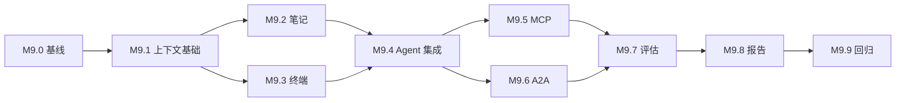

# v2.0 任务执行提示词清单

> 配套需求：[`docs/v2.0-requirements.md`](v2.0-requirements.md)  
> 用途：把 v2.0 拆成可独立执行的任务，每个任务一段提示词，逐段交给编码 Agent。  
> 原则：**一次只执行一个任务**；先测试后实现；每个任务验收通过后再进入下一个。

---

## 0. 执行总览

| 任务 | 目标 | 依赖 | 主要产出 | 验收命令 |
|---|---|---|---|---|
| M9.0 | 需求冻结与基线（只读） | 无 | 基线报告 | `py -3.14 -m pytest -q` |
| M9.1 | 上下文基础层 | M9.0 | `context/`（Packet/Config/Scoring/Sources/Compress/Builder） | `py -3.14 -m pytest tests/test_context_*.py -q` |
| M9.2 | 笔记系统 | M9.1 | `notes/` + `NoteTool` + `NoteContextSource` | `py -3.14 -m pytest tests/test_notes_*.py tests/test_note_tool.py -q` |
| M9.3 | 终端工具 | M9.1 | `TerminalTool` + 安全矩阵 | `py -3.14 -m pytest tests/test_terminal_tool.py -q` |
| M9.4 | Agent 集成 | M9.1–9.3 | 可选注入三范式 + `context.build` | `py -3.14 -m pytest tests/test_agent_context_injection.py -q` |
| M9.5 | MCP | M9.4 | JSON-RPC / Client / Server / MCPTool + Demo | `py -3.14 -m pytest tests/test_mcp_*.py -q` |
| M9.6 | A2A | M9.4 | Types / Server / Client / A2ATool + Demo | `py -3.14 -m pytest tests/test_a2a_*.py -q` |
| M9.7 | 评估体系 | M9.4–9.6 | 数据集 + 指标 + Evaluator + `eval_v2.py` | `py -3.14 -m pytest tests/test_eval_*.py -q` |
| M9.8 | 对比实验与报告 | M9.7 | `docs/v2.0-eval-report.md` | `py -3.14 scripts/eval_v2.py --suite all` |
| M9.9 | 回归与交付检查 | 全部 | 交付检查报告 | 见任务 10 |



**执行建议**

1. 每个任务单独开一个对话/会话，避免上下文互相污染。
2. 每次先贴「通用前缀」，再贴对应任务提示词。
3. 任务完成后先看 diff、跑验收命令，再 commit；不要一次让 Agent 跑完 M9.1–M9.7。
4. 如果 Agent 试图跨任务改代码，立即停止，要求它只做当前任务。
5. 如果发现需求冲突，先改需求文档，再改代码。

---

## 1. 通用前缀（每个任务都要带）

```text
你在 D:\Pre-research\Hello-Agents\agentflow 仓库内执行 v2.0（M9.x）任务。

开始前先完整阅读：
- docs/v2.0-requirements.md（唯一需求来源）
- docs/architecture.md
- docs/api-design.md
- 当前任务涉及的源码与测试

硬约束：
1. 不改变 v1.0 / M8 已有公开行为；现有 292 passed / 3 skipped 必须保持全绿。
2. 新能力默认关闭；context_builder=None 时行为与 v1.0 完全一致。
3. 默认离线可跑；不联网、不依赖真实 API Key；外部服务缺失时给出清晰错误或 skip。
4. 不引入 langchain / llama-index / sentence-transformers / torch 等重依赖；新增依赖只放 optional extras。
5. 所有公开类/方法写类型注解和中文 docstring；异常继承 agentflow.core.exceptions 的既有层级。
6. 只做本任务范围，不顺手重构无关代码；发现需求冲突先停下来说明。
7. 实现顺序：先写/补测试，再实现，最后跑全量回归。
8. 完成后按以下格式汇报：
   - 变更文件
   - 核心设计
   - 测试命令与结果
   - 验收命令与结果
   - 未完成项 / 风险
```

---

## 2. 任务提示词

### 任务 1 · M9.0 需求冻结与基线（只读）

**目标**：确认当前仓库基线与 v1.1 评估基线，不改业务代码。  
**依赖**：无。  
**产出**：
- `docs/v2.0-requirements.md` 与 `docs/v2.0-task-prompts.md` 已就位。
- 基线报告：测试数量、`scripts/eval_rag.py` 关键指标、当前 git commit。
- 确认 M9.1 的文件落点与接口签名。

**步骤**：
1. 运行 `py -3.14 -m pytest -q`，记录 passed/skipped。
2. 运行 `py -3.14 scripts/eval_rag.py --out docs/_baseline-rag-eval.md`（或现有命令），保存基线。
3. 对照需求文档第 7 节，确认 M9.1 接口。
4. 不修改任何源码。

**验收**：基线数字与需求文档一致；生成基线快照文件（可删除）。

---

### 任务 2 · M9.1 上下文基础层

**目标**：实现 `agentflow/context/` 的纯离线核心，不接 Agent、不接 LLM。  
**依赖**：M9.0。  
**产出**：
- `agentflow/context/types.py`：`ContextPacket` / `ContextConfig` / `BuiltContext` / `SectionTemplate`。
- `agentflow/context/scoring.py`：`JaccardScorer` / `recency_score` / `combine_score`。
- `agentflow/context/sources.py`：`ContextSource` + `Static` / `Memory` / `Retrieval` / `History`。
- `agentflow/context/compress.py`：`truncate_to_tokens` / `PerSectionCompressor`。
- `agentflow/context/builder.py`：`ContextBuilder`（GSSC）。
- `agentflow/context/__init__.py`。
- `agentflow/core/exceptions.py`：新增 `ContextError`。
- `tests/test_context_types.py` / `test_context_scoring.py` / `test_context_sources.py` / `test_context_builder.py`。

**实现要点**：
1. `ContextPacket.token_count` 未提供时自动 `estimate_tokens`；`timestamp` 统一 UTC。
2. `ContextConfig` 用 pydantic，校验两个权重和为 1。
3. Gather：每个 Source 独立 try/except；系统指令 / Task / Output 始终保留；历史只取最近 N 条。
4. Select：trusted 包直接用给定相关性；其余用 Jaccard；综合分 `0.7×相关性 + 0.3×新近性`；过滤 + 贪心装填。
5. Structure：六分区，空分区省略，分区内按分降序。
6. Compress：超预算分区级截断，每区至少保留 `min_section_tokens`；总 tokens 不得超预算。
7. `BuiltContext` 暴露 `.text` / `.items`，与 `MemoryContext` 鸭子类型兼容。
8. 不在本任务改 `Agent` / `Config` / 三范式。

**验收**：
```powershell
py -3.14 -m pytest tests/test_context_types.py tests/test_context_scoring.py tests/test_context_sources.py tests/test_context_builder.py -q
py -3.14 -m pytest -q
```

---

### 任务 3 · M9.2 笔记系统

**目标**：实现 Markdown + YAML 笔记存储、`NoteTool` 与 ContextBuilder 集成。  
**依赖**：M9.1。  
**产出**：
- `agentflow/notes/types.py` / `store.py` / `source.py` / `__init__.py`。
- `agentflow/tools/note_tool.py`，并在 `agentflow/tools/__init__.py` 导出。
- `tests/test_notes_store.py` / `test_note_tool.py` / `test_note_source.py`。
- `NoteAutomation` 可放 P1，不在本任务阻塞。

**实现要点**：
1. 目录 `.data/notes/<user_id>/`；文件名即 ID；`notes_index.json`。
2. 轻量 front matter 解析，不引入 PyYAML；支持字符串/数字/布尔/行内列表。
3. 原子写入；`rebuild_index()`。
4. 七操作：create/read/update/search/list/summary/delete；失败返回 `错误: ...` 字符串。
5. 五类型与优先级；`NoteContextSource` 先 blocker 再 search 再 action，去重。
6. `trusted=True`，分区：blocker/action→state，其余→context。

**验收**：
```powershell
py -3.14 -m pytest tests/test_notes_store.py tests/test_note_tool.py tests/test_note_source.py -q
py -3.14 -m pytest -q
```

---

### 任务 4 · M9.3 终端工具

**目标**：实现安全的只读 TerminalTool，支撑 JIT 上下文。  
**依赖**：M9.1。  
**产出**：
- `agentflow/tools/terminal_tool.py`，并在 `agentflow/tools/__init__.py` 导出。
- `tests/test_terminal_tool.py`。

**实现要点**：
1. 四层安全：白名单、workspace 沙箱、超时、输出截断。
2. `shell=False` + `shlex.split`；拒绝 `; & | > < \` $ ( )`。
3. 路径参数 `resolve` 后必须 `relative_to(workspace)`；禁止 `..`、绝对路径越界、符号链接逃逸。
4. `cd` 有真实状态；`cd ~` 回 workspace；`pwd` 可用。
5. `allow_pipes=True` 时按 `|` 分段校验并用 `Popen` 串联，不走 shell。
6. 合并 stderr；非零退出码加 `[exit N]`；异常返回错误字符串。
7. 输出字节与字符双上限。

**验收**：
```powershell
py -3.14 -m pytest tests/test_terminal_tool.py -q
py -3.14 -m pytest -q
```

---

### 任务 5 · M9.4 Agent 集成

**目标**：让三范式可选使用 ContextBuilder，且默认行为不变。  
**依赖**：M9.1–M9.3。  
**产出**：
- `agentflow/core/agent.py`：新增 `context_builder` 参数与 `context.build` Trace。
- `agentflow/core/config.py`：新增 `ContextConfig` 分组读取（可从 `context.types` 复用）。
- 三范式按需消费 `BuiltContext`。
- `tests/test_agent_context_injection.py`。

**实现要点**：
1. `context_builder is None` 时完全走 `_prepare_memory_context()`，消息列表与现有测试一致。
2. 有 builder 时构建 `BuiltContext`，把 `built.text` 注入；`memory.record_turn()` 不变。
3. 注入失败降级为无上下文并 emit `context.build` / 错误 Trace。
4. 新增 `StatsCallback` 计数。
5. 不做协议、不做评估。

**验收**：
```powershell
py -3.14 -m pytest tests/test_agent_context_injection.py -q
py -3.14 -m pytest -q
```

---

### 任务 6 · M9.5 MCP 接入

**目标**：实现最小 MCP client/server 与工具自动展开。  
**依赖**：M9.4。  
**产出**：
- `agentflow/protocols/mcp/jsonrpc.py` / `client.py` / `server.py` / `tool.py` / `__init__.py`。
- `examples/mcp_server_travel.py` / `examples/demo_mcp_travel.py`。
- `tests/test_mcp_jsonrpc.py` / `test_mcp_client_server.py` / `test_mcp_tool.py`。

**实现要点**：
1. JSON-RPC 2.0，stdio，换行分隔，UTF-8；内存 transport 供测试。
2. 方法子集：`initialize` / `tools/list` / `tools/call`。
3. `MCPTool.expand()` 返回带前缀包装工具；`inputSchema` 转 `ToolParameter`；类型转换。
4. 超时、进程退出、错误响应映射为 `MCPError`；关闭时清理进程树。
5. 自建 server 用 docstring 作工具描述。
6. 官方 SDK 不在本任务；不装 Node 依赖。

**验收**：
```powershell
py -3.14 -m pytest tests/test_mcp_jsonrpc.py tests/test_mcp_client_server.py tests/test_mcp_tool.py -q
py -3.14 -m examples.demo_mcp_travel
py -3.14 -m pytest -q
```

---

### 任务 7 · M9.6 A2A 协作

**目标**：实现最小 A2A 类型、server/client/tool 与三 Agent Demo。  
**依赖**：M9.4。  
**产出**：
- `agentflow/protocols/a2a/types.py` / `server.py` / `client.py` / `tool.py` / `__init__.py`。
- `examples/demo_a2a_travel.py`。
- `tests/test_a2a_types.py` / `test_a2a_server_client.py` / `test_a2a_tool.py`。

**实现要点**：
1. AgentCard / Skill / Task / TaskStatus / Artifact；生命周期校验。
2. 端点：card、创建任务、查询、取消；stdlib `ThreadingHTTPServer`。
3. `@server.skill` 注册；成功/失败/取消状态；默认 `127.0.0.1`、端口 0、请求体 1MB。
4. `A2AClient.execute_skill()` 轮询终态；`A2ATool` 把远程 Agent 变成 Tool。
5. **只用 JSON，绝不 `eval`**。
6. Demo 离线确定性技能，`--online` 可选真实 LLM。

**验收**：
```powershell
py -3.14 -m pytest tests/test_a2a_types.py tests/test_a2a_server_client.py tests/test_a2a_tool.py -q
py -3.14 -m examples.demo_a2a_travel
py -3.14 -m pytest -q
```

---

### 任务 8 · M9.7 评估体系

**目标**：实现三套基准、指标、EvaluationTool 与脚本。  
**依赖**：M9.4–M9.6。  
**产出**：
- `agentflow/evaluation/types.py` / `dataset.py` / `metrics/*` / `evaluators/*` / `report.py` / `tool.py` / `__init__.py`。
- `data/eval/tool_calling.jsonl` / `itinerary_tasks.jsonl`；扩展现有 `travel_qa.jsonl`。
- `scripts/eval_v2.py`。
- `tests/test_eval_tool_calling.py` / `test_eval_qa.py` / `test_eval_judge.py` / `test_eval_report.py`。

**实现要点**：
1. AST 匹配三条件；安全求值只用字面量与四则运算，不 `eval`。
2. QEM 归一化；引用覆盖。
3. LLM Judge 4 维 + JSON 容错；Win Rate 交换 A/B。
4. 从 Tracer `tool` 事件提取实际调用。
5. 渐进式 `--limit` / `--category` / `--dry-run`；结果 JSON + Markdown。
6. 单测不联网；Judge 用 fake LLM。

**验收**：
```powershell
py -3.14 -m pytest tests/test_eval_tool_calling.py tests/test_eval_qa.py tests/test_eval_judge.py tests/test_eval_report.py -q
py -3.14 scripts/eval_v2.py --suite all --limit 5
py -3.14 -m pytest -q
```

---

### 任务 9 · M9.8 对比实验与报告

**目标**：跑 S0–S5 消融并生成 D13。  
**依赖**：M9.7。  
**产出**：
- `docs/v2.0-eval-report.md`。
- `demo_output/eval_v2/<timestamp>/`：原始 JSON、轨迹、manifest。

**实验设置**：
- S0 v1.1；S1 +ContextBuilder；S2 +Notes；S3 +Terminal；S4 +MCP；S5 +A2A。
- 温度 0；记录模型、prompt 哈希、数据集 SHA、git commit。
- 先 `--limit 5` 冒烟，再全量。

**验收**：报告含结果表、消融、错误分析、结论、局限、复现命令；每张表可追溯到 JSON。

---

### 任务 10 · M9.9 回归与交付检查

**目标**：全量回归、文档与交付检查。  
**依赖**：全部。  
**产出**：
- `docs/v2.0-delivery-check.md`。
- 更新 `README.md`、`docs/architecture.md`、`docs/api-design.md`、`docs/architecture.png`。
- 版本号 `2.0.0`。

**验收**：
```powershell
py -3.14 -m pytest -q
py -3.14 -m examples.demo_context_engineering
py -3.14 -m examples.demo_mcp_travel
py -3.14 -m examples.demo_a2a_travel
py -3.14 scripts/eval_v2.py --suite all --limit 5
```

检查清单：
- [ ] 现有测试全绿。
- [ ] 新能力默认关闭时行为不变。
- [ ] 三个 Demo 离线跑通。
- [ ] 评估脚本 `--limit 5` 跑通。
- [ ] D13 报告完成。
- [ ] 文档与版本号更新。
- [ ] 未完成项 / P1 / 风险明确。
